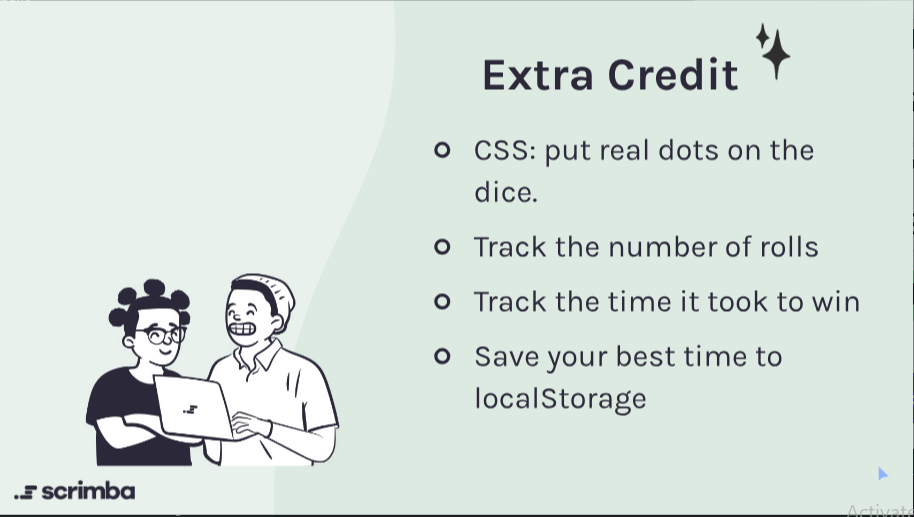

# Tenzies – React Dice Game

A small React game: roll 10 dice and keep "holding" dice until all ten show the same number.



## Features

- Click a die to hold/unhold it, then roll the rest
- Win detection when all dice are held and equal, with a confetti celebration
- Tracks the number of rolls and the time taken to win
- New game reset

## Built with

React 18 (hooks: `useState`, `useEffect`), Vite, react-confetti

## Run locally

```bash
npm install
npm run dev
```

Built while learning React with the Scrimba "Learn React" course (2024).
